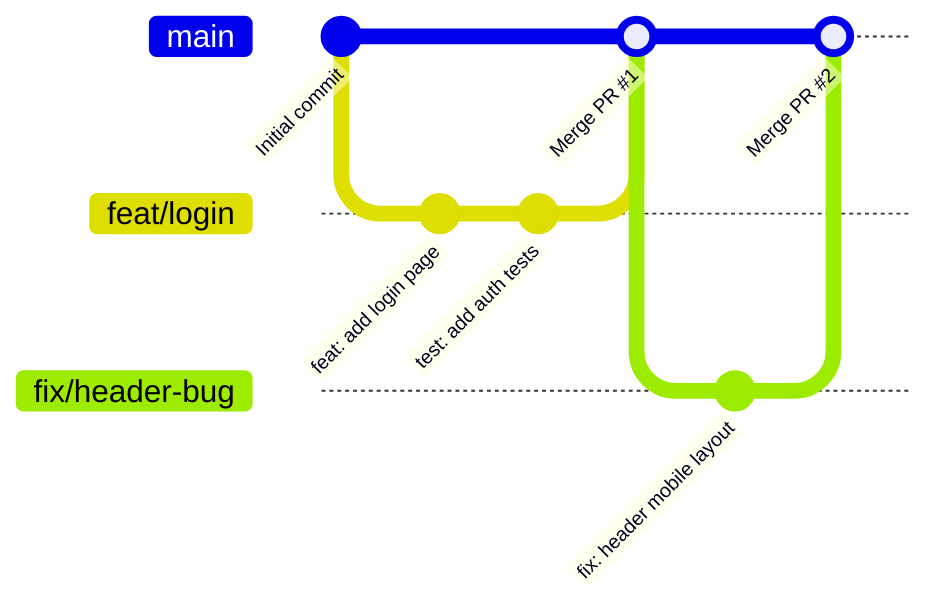

# Contributing Guide (기여 가이드)

프로젝트에 기여해 주셔서 감사합니다! 이 문서는 원활한 협업을 위한 브랜치 전략, 커밋 컨벤션, Pull Request(PR) 워크플로우를 안내합니다.

---

## 🌳 브랜치 전략: GitHub Flow

본 프로젝트는 단순하고 빠른 배포 주기와 협업을 위해 **GitHub Flow**를 기본 브랜치 전략으로 채택합니다.



### GitHub Flow 핵심 원칙

1. **`main` 브랜치는 항상 안정적이고 배포 가능한 상태를 유지합니다.**
   - 직접 `main` 브랜치에 커밋(`git commit` & `git push origin main`)하지 않습니다.
   - 모든 변경 사항은 별도 브랜치에서 작업 후 PR을 통해 병합됩니다.

2. **새로운 작업은 항상 최신 `main` 브랜치에서 새 브랜치를 생성하여 시작합니다.**
   ```bash
   git checkout main
   git pull origin main
   git checkout -b <prefix>/<branch-name>
   ```

3. **브랜치 네이밍 규칙 (Branch Naming Convention)**
   - 브랜치명은 목적을 명확히 알 수 있도록 접두사(Prefix)와 간결한 설명을 kebab-case로 작성합니다.
   - 접두사 종류:
     - `feat/`: 새로운 기능 추가 (예: `feat/user-auth`, `feat/issue-12-signup`)
     - `fix/`: 버그 수정 (예: `fix/login-token-error`)
     - `refactor/`: 코드 리팩터링 (예: `refactor/api-client`)
     - `style/`: 코드 포맷팅, 스타일 변경 (기능 변화 없음)
     - `docs/`: 문서 작성 및 수정 (예: `docs/update-readme`)
     - `test/`: 테스트 코드 추가 및 수정
     - `chore/`: 빌드 설정, 패키지 매니저 관리 등 기타 작업

4. **수시로 원격 저장소에 Push하여 변경 사항을 공유합니다.**
   ```bash
   git push -u origin <branch-name>
   ```

5. **작업 완료(또는 피드백 요청) 시 Pull Request(PR)를 생성합니다.**
   - PR 제목은 작업 내용을 요약하여 작성합니다.
   - PR 본문 템플릿(작업 내용, 변경 이유, 테스트 방법 등)을 충실히 기재합니다.
   - 리뷰어(Reviewer)를 지정하여 코드 리뷰를 요청합니다.

6. **코드 리뷰 및 CI 통과 후 `main`에 병합(Merge)합니다.**
   - 최소 1명 이상의 승인(Approval)을 받은 후 병합을 진행합니다.
   - 병합 방식: 프로젝트 정책에 따라 **Squash and Merge** 또는 **Rebase and Merge**를 권장합니다.

7. **병합이 완료된 브랜치는 즉시 삭제합니다.**
   - 로컬 및 원격 브랜치를 정리하여 저장소를 청결하게 유지합니다.
   ```bash
   git checkout main
   git pull origin main
   git branch -d <branch-name>
   ```

---

## 📝 커밋 메시지 규칙 (Commit Convention)

일관된 커밋 히스토리를 위해 **Conventional Commits** 형식을 따릅니다:

```text
<type>: <description>

[optional body]

[optional footer(s)]
```

### 커밋 타입 (Type)
- `feat`: 새로운 기능 추가
- `fix`: 버그 수정
- `docs`: 문서 변경
- `style`: 코드 포맷팅, 세미콜론 누락 등 (코드 동작 변경 없음)
- `refactor`: 리팩터링 (버그 수정이나 기능 추가 없는 코드 개선)
- `test`: 테스트 코드 추가 또는 수정
- `chore`: 빌드 업무 수정, 패키지 매니저 설정 등

### 작성 예시
```text
feat: 사용자 로그인 API 연동
fix: 모바일 화면에서 헤더 텍스트 잘림 현상 해결
docs: CONTRIBUTING.md 브랜치 전략 가이드 추가
```

---

## 💻 로컬 개발 환경 실행

### Frontend (React + TypeScript + Tailwind)
```bash
cd frontend
npm install
npm run dev
```

### Backend (FastAPI + uv)
```bash
cd backend
uv run uvicorn backend.main:app --reload
```
